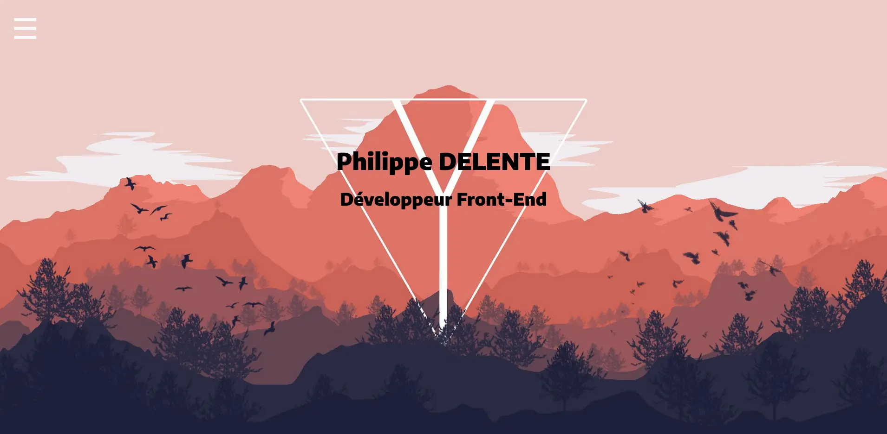

# Portfolio PhilDaiguille

## Philippe Delente

### Étudiant 5ème Année - Mastère Ingénieurie du web 

Je suis un étudiant en 5ème année de Mastère Ingénieurie du web, passionné par le développement front-end et la création d'expériences utilisateur engageantes. Mon portfolio présente mes projets, compétences et réalisations dans le domaine du développement web.

- Pour voir le portfolio en question : **[PhilDaiguille](https://www.phildaiguille.fr/)**.*.

## Credits

- [**Philippe DELENTE**](https://github.com/PhilDaiguille) : Développeur front-end.
